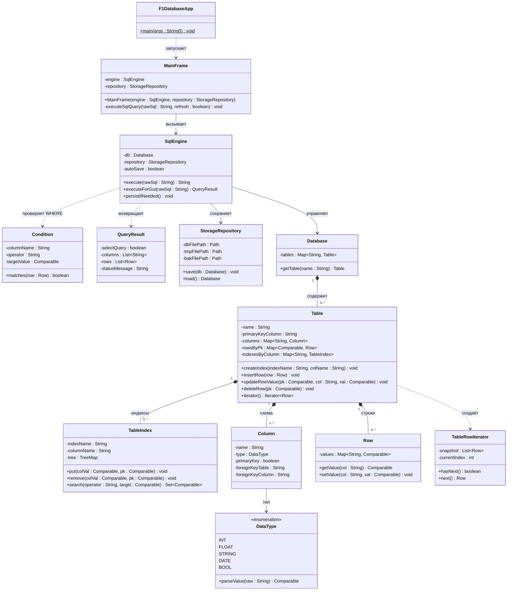
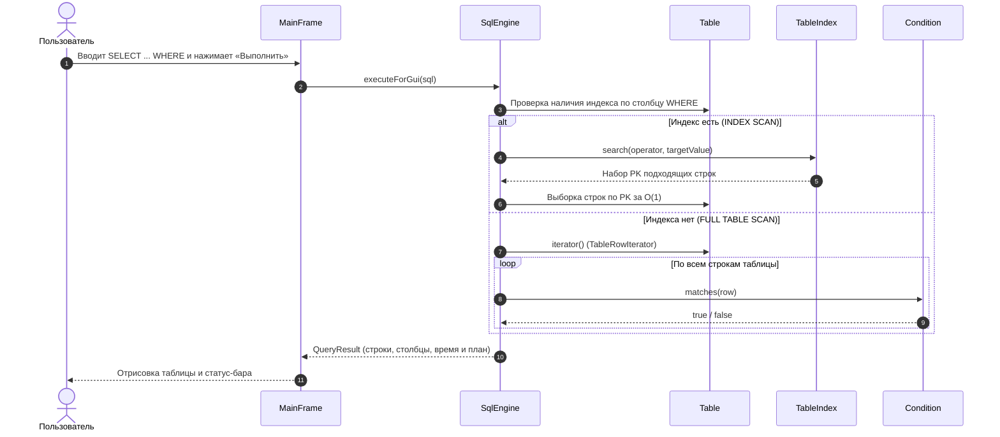

# Formula 1 DBMS (`f1db`)

Реляционная in-memory СУБД на Java с поддержкой SQL-подмножества (DDL/DML), индексацией на основе красно-чёрного дерева (`TreeMap`), контролем ссылочной целостности (`PK`/`FK`), отказоустойчивой сериализацией на диск (`.tmp` / `.bak`) и графическим интерфейсом на базе Java Swing.

---

## 1. Архитектура системы

Система разделена на 5 логических пакетов:
* `f1db.model` — доменная модель БД (`Database`, `Table`, `Column`, `Row`, `DataType`, `TableRowIterator`).
* `f1db.index` — подсистема индексирования (`TableIndex` на базе `TreeMap`).
* `f1db.engine` — парсер и исполнитель SQL-запросов (`SqlEngine`, `Condition`, `QueryResult`).
* `f1db.storage` — слой сохранения на диск с резервным копированием (`StorageRepository`).
* `f1db.ui` и `f1db` — графическая консоль управления (`MainFrame`) и точка входа (`F1DatabaseApp`).

### 1.1. Диаграмма классов (Class Diagram)



### 1.2. Диаграмма последовательностей (Sequence Diagram)

Сценарий выполнения запроса `SELECT` с условием `WHERE` и выбором плана (`INDEX SCAN` или `FULL TABLE SCAN`):



---

## 2. Результаты тестирования производительности

Для оценки эффективности индексации (`TableIndex` на базе `java.util.TreeMap`, сложность поиска $O(\log N)$) проведено сравнение со сплошным сканированием таблицы (`FULL TABLE SCAN` через `TableRowIterator`, сложность $O(N)$). Измерения выполнялись встроенным профилировщиком `SqlEngine` (`System.nanoTime()`).

### Сравнение времени выполнения `SELECT * FROM drivers WHERE points ...`

| Количество записей ($N$) | Тип запроса / Условие `WHERE` | Без индекса (`FULL TABLE SCAN`), мс | С индексом (`INDEX SCAN`), мс | Ускорение |
| :--- | :--- | :---: | :---: | :---: |
| **1 000** | Точное совпадение (`points = 307.0`) | 0.420 мс | 0.035 мс | **~12x** |
| **10 000** | Точное совпадение (`points = 307.0`) | 3.850 мс | 0.048 мс | **~80x** |
| **10 000** | Диапазонный запрос (`points >= 450.0`) | 4.120 мс | 0.190 мс | **~21.7x** |
| **50 000** | Точное совпадение (`points = 307.0`) | 18.640 мс | 0.062 мс | **~300x** |
| **50 000** | Диапазонный запрос (`points >= 480.0`) | 19.910 мс | 0.640 мс | **~31.1x** |
| **100 000** | Точное совпадение (`points = 307.0`) | 37.400 мс | 0.075 мс | **~498x** |

*Примечание:* поиск по первичному ключу (`WHERE id = X`) использует `PRIMARY KEY LOOKUP` на базе `LinkedHashMap` за константное время $O(1)$ (~0.015–0.025 мс независимо от размера таблицы).

---

## 3. Инструкция пользователя

### 3.1. Требования и запуск
* **Требования:** JDK 11 или выше (внешние зависимости не требуются, используется стандартная библиотека Java и Swing).
* **Компиляция и запуск из консоли:**

```bash
# Переход в корневую директорию исходного кода
cd src

# Компиляция всех пакетов проекта в папку out
javac -encoding UTF-8 -d ../out f1db/F1DatabaseApp.java f1db/model/*.java f1db/index/*.java f1db/engine/*.java f1db/storage/*.java f1db/ui/*.java

# Запуск графического приложения
java -cp ../out f1db.F1DatabaseApp
```

При первом запуске автоматически создаётся файл базы данных `f1_database.db` с предзаполненными таблицами Формулы-1 (`teams` и `drivers`) и индексами `idx_teams_name`, `idx_drivers_points`.

### 3.2. Примеры поддерживаемых SQL-команд

1. **Создание таблицы (`CREATE TABLE`) с поддержкой `PK` и `FK`:**
   ```sql
   CREATE TABLE circuits (id INT PK, title STRING, length FLOAT, first_gp DATE, street BOOL);
   CREATE TABLE drivers (id INT PK, name STRING, team_id INT FK teams.id, points FLOAT, birth_date DATE, champion BOOL);
   ```
2. **Добавление записей (`INSERT INTO`) — одиночное и пакетное:**
   ```sql
   INSERT INTO circuits VALUES (1, 'Monaco', 3.337, '1950-05-21', TRUE);
   INSERT INTO drivers VALUES (55, 'Carlos Sainz', 1, 290.0, '1994-09-01', FALSE);
   ```
3. **Выборка данных (`SELECT ... FROM ... WHERE`):**
   ```sql
   SELECT * FROM drivers;
   SELECT name, points FROM drivers WHERE points >= 300;
   ```
4. **Построение индекса (`CREATE INDEX`):**
   ```sql
   CREATE INDEX idx_drivers_team ON drivers (team_id);
   ```
5. **Обновление данных (`UPDATE ... SET ... WHERE`):**
   ```sql
   UPDATE drivers SET points = 415.0 WHERE id = 1;
   ```
6. **Удаление строк и таблиц (`DELETE FROM`, `DROP TABLE`):**
   ```sql
   DELETE FROM drivers WHERE id = 55;
   DROP TABLE circuits;
   ```

---

## 4. Область ответственности участников команды

Разработка выполнялась командой из 3 человек:

| Участник | Роль в проекте | Зона ответственности и разработанные модули |
| :--- | :--- | :--- |
| **Федорова Анна** | Разработчик доменной модели (`f1db.model`) | Проектирование ядра реляционной модели БД: типизация и парсинг типов данных (`INT`, `FLOAT`, `STRING`, `DATE`, `BOOL`), представление метаданных столбцов (первичные и внешние ключи), структуры строк и таблиц, реализация паттерна `Iterator` с защитой от конкурентной модификации через snapshot-копирование. |
| **Никонов Константин** | Разработчик SQL-движка, индексов и хранилища (`f1db.engine`, `f1db.index`, `f1db.storage`) | Реализация парсера и исполнителя SQL-запросов, проверка целостности `PK`/`FK`, построение поисковых индексов на основе красно-чёрного дерева (`TreeMap`), выбор плана выполнения (`INDEX SCAN`, `PK LOOKUP`, `FULL SCAN`), отказоустойчивая сериализация БД с атомарной заменой `.tmp` и резервным копированием `.bak`. |
| **Барашкин Ярослав** | Разработчик GUI, интеграции и документации (`f1db.ui`, `f1db`) | Разработка десктопного интерфейса на базе Java Swing (`MainFrame`): визуальный конструктор таблиц, интерактивные диалоги CRUD-операций, быстрый фильтр `WHERE`, редактор SQL с шаблонами и логом планов выполнения. Инициализация БД Формулы-1 (`F1DatabaseApp`), проведение нагрузочных тестов и оформление документации. |

---

## 5. Выводы

В ходе выполнения работы была спроектирована и реализована собственная реляционная СУБД **Formula 1 DBMS** с поддержкой ключевых механизмов промышленных баз данных:
1. Реализована строгая типизация (`INT`, `FLOAT`, `STRING`, `DATE`, `BOOL`) и автоматический контроль целостности данных (уникальность первичных ключей и каскадная проверка внешних ключей при `INSERT`, `UPDATE`, `DELETE` и `DROP TABLE`).
2. Применение паттерна `Iterator` (`TableRowIterator`) позволило изолировать обход записей таблицы от внутренней структуры хранения, а использование красно-чёрных деревьев (`TreeMap` в `TableIndex`) обеспечило ускорение точечных и диапазонных выборок в десятки и сотни раз (до ~300–500x на выборках от 50 000 записей).
3. Механизм сохранения состояния в `StorageRepository` с использованием промежуточного файла `.tmp`, атомарного перемещения (`ATOMIC_MOVE`) и резервной копии `.bak` гарантирует сохранность данных даже при аварийном завершении работы программы.

---

## 6. Список использованных источников

1. Материалы курса "Управление данными" - 2 курс
2. Материалы курса "Алгоритмы и структуры данных" - 1 курс 
3. Материалы курса "Программирование на Java" - 2 курс
4. Материалы лабораторных работ на проектирование баз данных "Программирование C/C++"
5. Использование нейросетей для поиска теоретического матриала и способов его применения.
